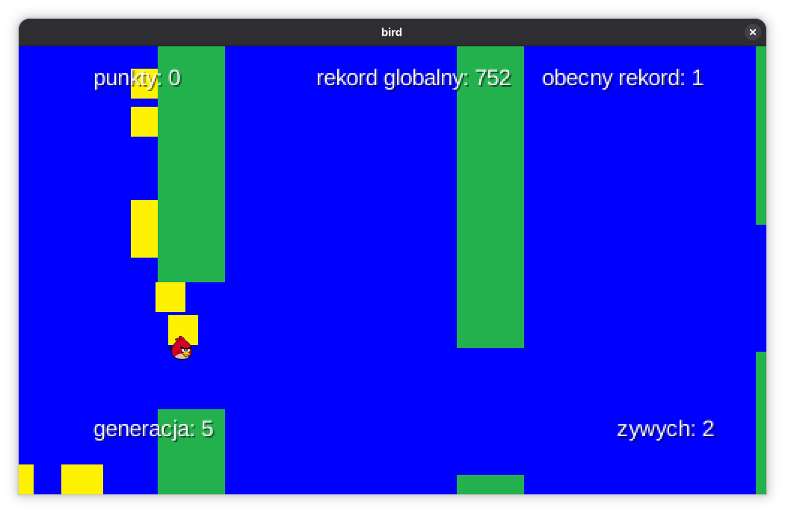
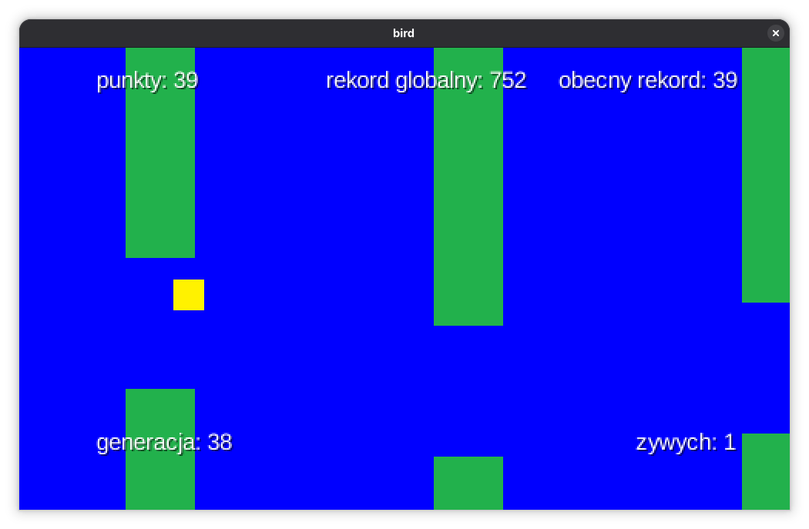

# projektBIRD

A desktop Flappy Bird-style simulation built with Java and LibGDX. A population of birds learns to pass randomly positioned pipe gaps using a small neural network and a simple evolutionary algorithm.

## Screenshots





## Requirements

- JDK 17
- The included Gradle Wrapper (Gradle 7.5.1); a separate Gradle installation is not required

## Run

From the project root on Linux or macOS:

```sh
./gradlew :desktop:run
```

On Windows, run:

```bat
gradlew.bat :desktop:run
```

The desktop window opens at 1000 x 600 pixels. To compile the project without starting the game, use `./gradlew build` (or `gradlew.bat build` on Windows).

## Controls

- `R`: restart the simulation and load the saved neural network for one bird.
- `Space`: end the current generation by removing all living birds.

The other birds in a generation are controlled automatically.

## How it works

- Each generation contains 500 birds. Each bird receives four normalized inputs: the next gap's horizontal position and lower edge, the bird's vertical position, and its vertical velocity.
- A fully connected 4-4-1 neural network with sigmoid activations decides whether the bird should jump.
- Fitness is the square of the time a bird stays alive. At the end of a generation, birds are selected with probability proportional to their fitness; their network weights and biases are independently mutated with a 12% chance per value. The best bird is carried into the next generation unchanged.
- Pipes move across the screen, and their gaps are placed at random vertical positions. The simulation updates and renders through LibGDX's game loop.

## Libraries and project structure

- **LibGDX 1.12.0** provides the game lifecycle, graphics, textures, input, and desktop game API.
- **LWJGL3** is the LibGDX desktop backend used to create the application window.
- The neural network and matrix operations are implemented in the project; no external machine-learning library is used. Java's standard library is used for random values and serialization.

`core/` contains the game and simulation code. `desktop/` contains the desktop launcher. `assets/` contains the bird and pipe textures, fonts, high-score file, and serialized neural network.

## Saved data

The desktop run task uses `assets/` as its working directory. The game reads and updates `highScore.txt` there and saves the best network to `serialized_neural_network.ser` when a new all-time high score is recorded. Pressing `R` loads that network for a single bird.